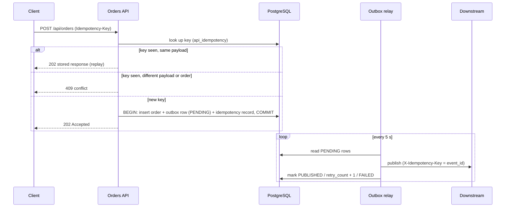

# Resilient Orders API on Mule 4

An order-intake API built with MuleSoft (Mule 4.12, Java 17) that is designed to survive duplicates, retries and downstream failures. A client posts an order; the API validates it, stores it in PostgreSQL in one transaction together with an outbox event, and answers 202. A separate flow publishes the outbox to downstream systems.

## What it demonstrates

| Area | Where | What it shows |
|---|---|---|
| Contract-first API | `src/main/resources/api/` | RAML spec with shared types and examples, `POST /orders` |
| Idempotency | `orders/orders-api.xml`, `db/schema.sql` | `Idempotency-Key` header, `api_idempotency` table, request-hash check, in-progress detection |
| Transactions | `orders/orders-api.xml` | Order row and outbox row written in one DB transaction (`ALWAYS_BEGIN`) |
| Outbox pattern | `order_outbox` table, `self-healing/09-outbox-relay.xml` | Events are saved with the order and published later, at-least-once |
| Validation errors | `orders/orders-api.xml` | Typed error codes: `DUPLICATE_ORDER`, `PRICING_VALIDATION_FAILED`, `PAYMENT_VALIDATION_FAILED`, `IDEMPOTENCY_KEY_CONFLICT`, `IDEMPOTENCY_PAYLOAD_CONFLICT`, `REQUEST_IN_PROGRESS` |
| Kafka | `orders/order-notification-consumer.xml` | Consumer with a `processed_events` table so a repeated event is harmless |
| Integration patterns | `src/main/mule/patterns/`, `docs/patterns/` | Scatter-Gather, Content Enricher, Splitter/Aggregator (foreach, parallel-foreach, batch, aggregators module), Recipient List, Message Filter, Claim Check (S3) |
| Self-healing | `src/main/mule/self-healing/`, `docs/self-healing/README.md` | Fixed retry, exponential backoff with jitter, total time budget, retry queue, circuit breaker, permanent-error handling, a mock downstream with an UP/DOWN switch |
| Tests | `src/test/munit/` | MUnit suite |
| CI | `.github/workflows/mule-ci.yml` | Build, test and package on push and pull request |

## Architecture

```
Client -- POST /api/orders (Idempotency-Key) --> Mule API
                                                  |  validate, idempotency check
                                                  |  one DB transaction:
                                                  |    orders + order_outbox (PENDING)
                                                  v
                                             PostgreSQL
                                                  |
              outbox relay (every 5 s) <----------+
                  | publish with a stable event_id key
                  v
        downstream / Kafka  -->  consumer (processed_events de-dup)
```

## Order flow



## Design decisions and trade-offs

- **Idempotency in the database, not in memory.** A key plus a hash of the request is stored in PostgreSQL, so a replay is recognised after a restart and across workers. A repeat with the same key and body returns the stored response; the same key with a different body or a different order is a 409. Trade-off: one extra read and write per request.
- **The database enforces the race.** Two concurrent requests with the same key or the same external order id are decided by unique constraints, not by the check in the flow, which two requests can both pass. The loser gets a 409.
- **Outbox instead of publishing inside the request.** The order and its event are saved in one transaction and published later. That removes the "saved but not published" gap, at the cost of at-least-once delivery, so the receiver must tolerate repeats. The relay sends a stable `event_id` as the idempotency key for that reason.
- **Retry with backoff and jitter, capped by a time budget.** Doubling waits with random jitter avoid synchronized retries, and a total budget stops a retry loop from outlasting the caller's timeout. Trade-off: the loop holds a thread while it waits.
- **Retry only temporary failures.** Permanent errors are marked failed immediately and are not retried.
- **Circuit breaker for outages.** Retry handles a blip; the breaker stops calling a dependency that is down.

## Verified behaviour

These scenarios were run against the running API and the database.

| Scenario | Result |
|---|---|
| Valid order | 202 Accepted |
| Same `externalOrderId`, different idempotency key | First 202, second 409 `DUPLICATE_ORDER` |
| Invalid pricing | 400 `PRICING_VALIDATION_FAILED` |
| Invalid payment | 422 `PAYMENT_VALIDATION_FAILED` |
| Same key, different order | First 202, second 409 `IDEMPOTENCY_KEY_CONFLICT` |
| Same key, changed payload | 409 `IDEMPOTENCY_PAYLOAD_CONFLICT` |
| Same key, identical payload, sent twice | Both 202, same order, event and correlation ids: a replay, not a second insert |
| Two concurrent requests, same key | One 202, one 409 `REQUEST_IN_PROGRESS` |
| Two concurrent requests, same order id, different keys | One 202, one 409 `DUPLICATE_ORDER` (decided by the database) |
| Backoff retry against a downstream that comes back | Waits of 535, 1104 and 2188 ms, 4th attempt succeeded, same idempotency key on every attempt |
| Backoff with a 3000 ms budget | Stopped after 3 attempts, as the next wait would exceed the budget |
| Backoff with the default 6000 ms budget | Stopped after 4 attempts |

Written but not yet run end to end: circuit breaker (`07`), permanent-error handling (`08`) and the outbox relay (`09`).

## Run it locally

Needs Java 17, Maven, Docker and a Mule 4.12 runtime (Anypoint Code Builder or Studio).

1. Start PostgreSQL and Kafka:
   ```
   export POSTGRES_PASSWORD=<choose a password>
   docker compose up -d
   ```
2. Create the tables: run `db/schema.sql` against database `orderdb` (user `order_user`).
3. Create `src/main/resources/config/secure-dev.yaml` from `secure-example.yaml`, encrypting the values with the Mule Secure Properties Tool and your own key.
4. Run the app and pass the key at runtime: `-M-Dsecure.key=<your key>`. Port is 8081 (`http.port`).
5. Try it:
   ```
   curl -X POST http://localhost:8081/api/orders \
     -H "Content-Type: application/json" -H "Idempotency-Key: demo-1" \
     -d @src/main/resources/api/examples/order-request-example.json
   ```
   Send it twice: the second call returns the stored first response instead of creating a second order.

The S3 claim-check pattern needs AWS credentials in the secure file; the other flows do not.

## Layout

```
src/main/resources/api/        RAML contract, types, examples
src/main/mule/global/          shared connector and listener configs
src/main/mule/orders/          order API flow and Kafka notification consumer
src/main/mule/patterns/        integration pattern flows (01-06)
src/main/mule/self-healing/    retry, backoff, queue, breaker, outbox relay, mock downstream
src/test/munit/                MUnit tests
db/                            PostgreSQL schema
docs/patterns/                 one note per pattern
docs/self-healing/             retry and resilience options compared
scripts/                       helper scripts for tests
samples/                       sample payloads
observability/                 Grafana dashboard and OpenTelemetry collector config
_disabled-flows/               earlier versions kept for reference, not deployed
```

## Security notes

No keys, passwords or certificates are committed. `secure*.yaml`, `*.p12`, `*.key` and TLS material are git-ignored. The secure-properties key is supplied at runtime. Database credentials come from your environment.
